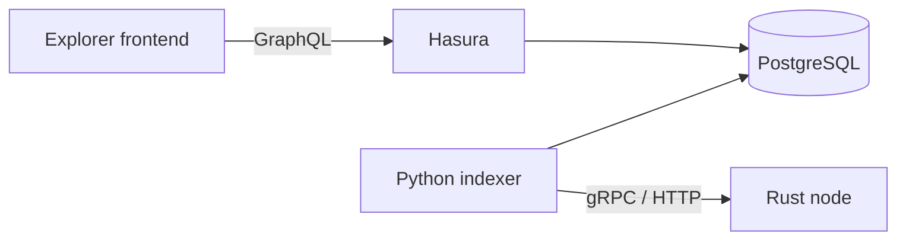

# Explorer components

The [explorer](https://github.com/asi-alliance/asi-chain-explorer/tree/0ae1eea64234c86937b3adf39fc6a5551b228f1a) is a React frontend served by nginx in its published image. It queries Hasura GraphQL.

The Python indexer performs extraction and database writes. Hasura provides relationships, permissions and GraphQL. These services are separate from the frontend container.

See [container images](/general/container-images/) for the published frontend digest and [data flow](/architecture/data-flow/) for revision boundaries. Browser-visible configuration must contain public endpoint URLs rather than administrator credentials.
