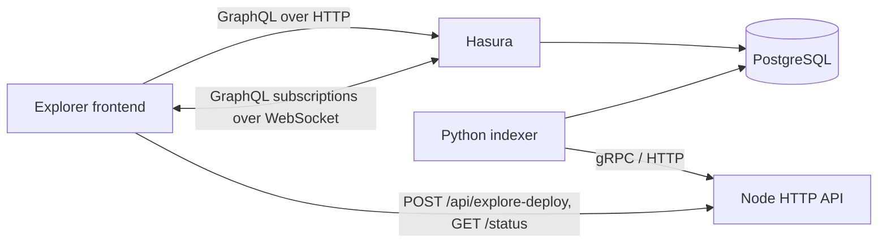
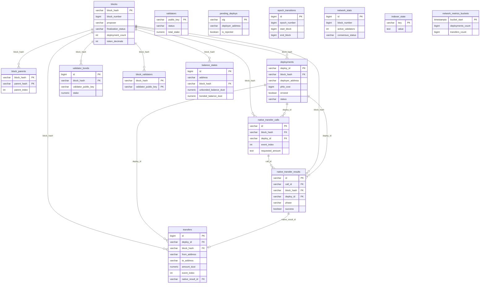

# Explorer Components

The explorer at [github.com/asi-alliance/asi-chain-explorer](https://github.com/asi-alliance/asi-chain-explorer/tree/0ae1eea64234c86937b3adf39fc6a5551b228f1a) is a React frontend served by nginx in its published image. It reads chain data from Hasura over GraphQL and talks to a node directly for wallet balance lookups.

The frontend uses three connections.

- Queries and mutations go to `REACT_APP_GRAPHQL_URL`.
- Live updates (new blocks, transfers, deployments, network statistics) arrive as GraphQL subscriptions over `REACT_APP_GRAPHQL_WS_URL`.
- The wallet balance lookup sends a Rholang balance query to `REACT_APP_RCHAIN_NODE_URL` with `POST /api/explore-deploy` and checks the node with `GET /status`. When `NODE_ENV` is `development`, the node URL is empty, so requests go to the same origin as the page.

The Python indexer performs extraction and database writes. Hasura provides relationships, permissions and GraphQL. These services are separate from the frontend container.

## Indexer Database

The indexer writes these tables to PostgreSQL. Hasura serves all of them except `native_transfer_calls`, `native_transfer_results` and `network_metrics_buckets`, and adds the `native_transfer_lifecycle` view. The diagram shows keys and the main columns from migrations 000 to 003 in [github.com/asi-alliance/asi-chain-indexer](https://github.com/asi-alliance/asi-chain-indexer/tree/71e80edb0bbae7dfbbab0e0393901edb70df471d/migrations). It leaves out the link table `native_transfer_result_aliases`, whose rows pair a `native_transfer_results` id with a `native_transfer_calls` id.

After migration 001, amounts in the smallest token unit (`amount_dust`, `stake`, `total_stake`, `bonded_balance_dust` and `unbonded_balance_dust`) are `NUMERIC(78,0)` and limited to the unsigned 256-bit range. The matching `*_asi` columns are `NUMERIC(155,77)`, and the generated totals in `balance_states` are one digit wider. Each of the tables `blocks`, `transfers`, `validators`, `validator_bonds` and `balance_states` carries a `token_decimals` column. The tables `validators`, `pending_deploys`, `epoch_transitions`, `network_stats`, `indexer_state` and `network_metrics_buckets` have no foreign keys. A `validators` row is linked to `validator_bonds` only by the public key value.

See [container images](/general/container-images/) for the published frontend and indexer revisions and [data flow](/architecture/data-flow/) for revision boundaries.
