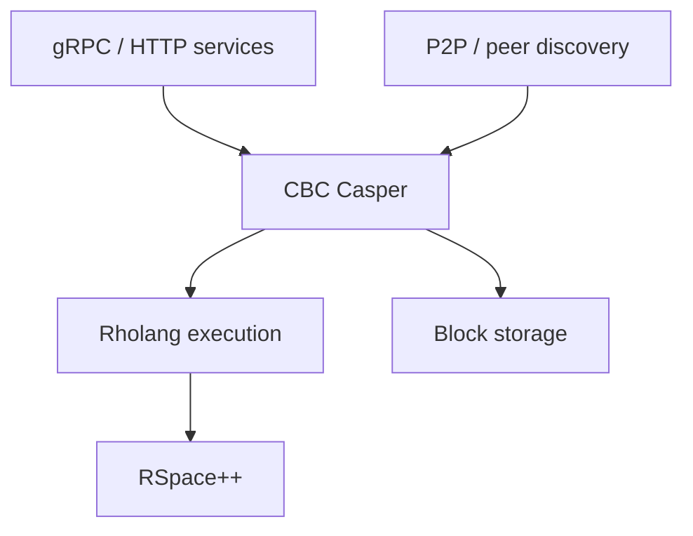

# Node components

The maintained [pure Rust source](https://github.com/asi-alliance/asi-chain-rust-node/tree/72c9126ca17b26c4b5c33b093422020cabe91f45) separates node services, consensus, contract execution, storage and networking into Rust crates.

The runtime binary is `/opt/docker/bin/node`; no Scala/JVM runtime configuration is required. See [validator image](/shard-nodes/validator-image/) for entrypoint, defaults, ports and access boundaries. Native-token metadata is part of shard/genesis configuration; upstream defaults do not establish ASI metadata for a deployed chain.
