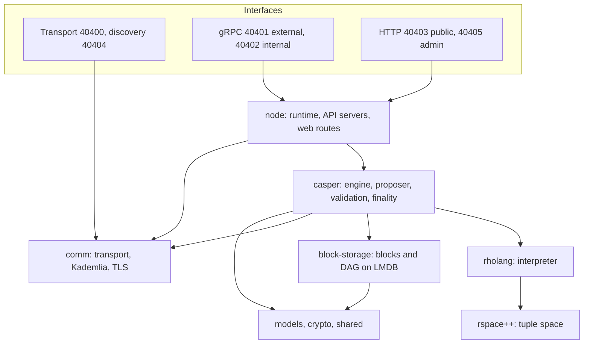

# Node Components

The maintained [pure Rust source](https://github.com/asi-alliance/asi-chain-rust-node/tree/e18defd44d43fe460379efefb88223797709a0cf) separates node services, consensus, contract execution, storage and networking into Rust crates. The public DevNet currently runs a Scala node; see the [architecture overview](/architecture/).

The runtime binary is `/opt/docker/bin/node`; no Scala/JVM runtime configuration is required. See [Validator Image](/shard-nodes/validator-image/) for entrypoint, defaults, ports and access boundaries. Native-token metadata is part of shard/genesis configuration; upstream defaults do not establish ASI metadata for a deployed chain.

## API

The HTTP API listens on port 40403. Most routes are under `/api`, while `/status`, `/version`, `/metrics` and the `/ws/events` WebSocket sit at the root. Swagger UI is at `/swagger-ui`. The block routes (`/api/block/{hash}`, `/api/last-finalized-block` and the `/api/blocks` routes) and `/api/deploy/{deploy_id}` take `?view=full|summary`, and the default differs by route.

| Endpoints | Purpose |
|---|---|
| `GET /api/status`, `GET /api/ready` | Node identity, sync state, `isReady`; readiness probe that returns 200 once the node is Running and 503 before |
| `GET`, `POST /api/prepare-deploy` | Data needed to build a deploy |
| `POST /api/deploy` | Submit a signed deploy |
| `POST /api/explore-deploy`, `/api/explore-deploy-by-block-hash`, `/api/data-at-name-by-block-hash` | Read-only Rholang execution and data reads |
| `GET /api/last-finalized-block`, `/api/block/{hash}`, `/api/blocks`, `/api/blocks/{start}/{end}`, `/api/blocks/{depth}` | Blocks |
| `GET /api/deploy/{deploy_id}`, `/api/is-finalized/{hash}`, `/api/deploy-finalization-status/{sig}`, `/api/pending-deploys` | Deploy status and finalization |
| `GET /api/balance/{address}`, `/api/registry/{uri}` | Balance and registry lookups |
| `GET /api/validators`, `/api/validator/{pubkey}`, `/api/bond-status/{pubkey}`, `/api/epoch`, `/api/epoch/rewards` | Validators, bonds and epochs |
| `POST /api/estimate-cost` | Cost estimate for a deploy |
| `GET /status`, `/version`, `/metrics`, `/ws/events` | Status, version, Prometheus metrics and an event stream |
| `/api/v1/*` | Versioned variants of status, deploy, explore-deploy and block routes |

The admin HTTP API on port 40405 has `POST /api/propose` and the admin variants under `/api/v1`. The external gRPC server on 40401 serves only the Deploy service. The internal gRPC server on 40402 serves Repl, Deploy, Propose and Lsp.

## Configuration

The node reads HOCON. The embedded `defaults.conf` is the base. A file at `<data-dir>/f1r3fly.conf`, or the path given with `--config-file`, overrides it, and command-line flags override both.

- `network-id` defaults to `testnet` and must be the same on every node of a network.
- The TLS key at `<data-dir>/node.key.pem` determines the node ID, so deleting the data directory gives the node a new identity.
- The heartbeat proposer is on by default and checks every 5 seconds.
- In Docker the data directory is `/var/lib/rnode`.

## Logs

The node logs through `tracing`. Three flags control it:

| Flag | Values |
|---|---|
| `--log-level <EXPR>` | An `EnvFilter` expression such as `info`; the `RUST_LOG` environment variable wins if set |
| `--log-format <FORMAT>` | `json` (default) or `pretty` |
| `--log-sink <SINK>` | `stdout` (default), `file` or `both`; the file is `<data-dir>/logs/node.log` |

The repository Compose files set `--log-sink=stdout`, so `docker logs` shows the output.
