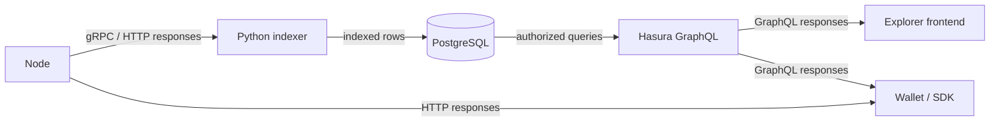

# Data Flow

## Indexing Path

The [indexer node client](https://github.com/asi-alliance/asi-chain-indexer/blob/71e80edb0bbae7dfbbab0e0393901edb70df471d/src/grpc_node_client.py) uses node gRPC and HTTP directly. PostgreSQL and Hasura are separate services, and the explorer neither extracts chain blocks nor owns the database.

The indexer polls the node every `SYNC_INTERVAL`. Besides blocks it reads bonds and the node's pending deploys. A separate `metrics-cron` service refreshes the aggregated network metrics every three minutes.

## Deploy Lifecycle

A deploy passes through separate states. Each one is visible through a different node endpoint, and a successful response at one step does not guarantee the next state.

```mermaid
flowchart LR
  Client[Client signs deploy] -->|POST /api/deploy| Pool[Pending deploy pool]
  Pool -->|proposer runs with constraints met| Block[Block created and signed]
  Block -->|Rholang executed in RSpace++| Broadcast[Broadcast to peers]
  Broadcast -->|peers validate| DAG[Block in the DAG]
  DAG -->|clique oracle| Final[Block finalized]
```

| State | What it means | Where to look |
|---|---|---|
| Pending | The node accepted the deploy and holds it in its local queue. Observers always answer with an empty list | `GET /api/pending-deploys` |
| In a block | A validator included the deploy, executed its Rholang and signed the block | `GET /api/deploy/{deploy_id}` |
| Finalized | The block that holds the deploy is finalized. Whether the deploy's effects were kept is reported per deploy | `GET /api/is-finalized/{hash}`, `GET /api/deploy-finalization-status/{sig}` |

A validator creates a block when its proposer triggers and both the synchrony and the height constraints hold. By default the heartbeat proposer checks every 5 seconds. Peers that receive the block validate it before adding it to their DAG.

A block can finalize while some of its deploys have their effects dropped during state merge. Poll `deploy-finalization-status` with the deploy signature rather than the block hash alone. `GET /api/deploy/{deploy_id}` returns 404 while no block known to the node contains the deploy, so a 404 right after submission does not mean the deploy was lost.

A successful API response or an indexed row alone does not prove a successful, finalized token transfer. Handle amounts as exact raw integers (atomic units).

## Node and GraphQL

| Data | Source | Interface |
|---|---|---|
| Balance of an address | Node | `GET /api/balance/{address}`, or a Rholang query through `POST /api/explore-deploy` |
| Deploy status and finalization | Node | `/api/deploy/{deploy_id}`, `/api/pending-deploys`, `/api/is-finalized/{hash}`, `/api/deploy-finalization-status/{sig}` |
| Latest blocks, validators, epoch | Node | `/api/last-finalized-block`, `/api/blocks`, `/api/validators`, `/api/epoch` |
| Transaction history of an address | Indexer through Hasura | GraphQL |
| Block and transfer lists, network statistics | Indexer through Hasura | GraphQL |

The wallet reads balances through the SDK from the node, and its history from GraphQL.

Migrations, Hasura relationships, permissions and endpoint selection must match the deployed indexer revision. Later cost-accounting and API changes do not change the [published indexer image](/reference/container-images/) automatically.
