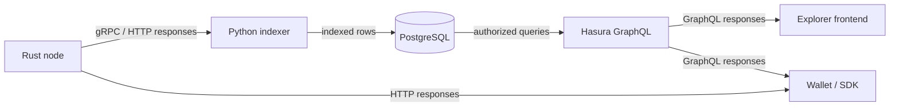

# Data flow

The [indexer node client](https://github.com/asi-alliance/asi-chain-indexer/blob/71e80edb0bbae7dfbbab0e0393901edb70df471d/src/grpc_node_client.py) uses node gRPC and HTTP directly. It does not invoke a Rust CLI. PostgreSQL and Hasura are separate services; the explorer neither extracts chain blocks nor owns the database.

Deploy submission, inclusion, execution results and canonical finalization are separate states. A successful API response or indexed row alone does not prove a successful, finalized token transfer. Use the selected node/client contract and exact raw integer amounts.

Migrations, Hasura relationships, permissions and endpoint selection must match the deployed indexer revision. Later cost-accounting/API candidates do not change the [published indexer artifact](/general/container-images/) automatically.
