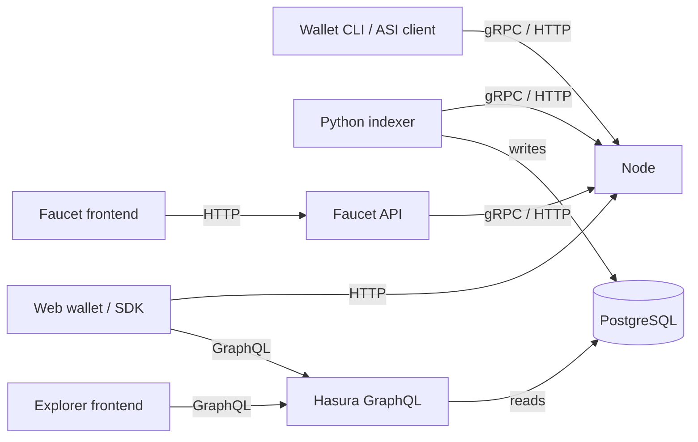

# Technical Architecture

The maintained node is implemented in Rust. It combines CBC Casper consensus, Rholang execution and RSpace++ storage with P2P, gRPC and HTTP services. See the [github.com/asi-alliance/asi-chain-rust-node](https://github.com/asi-alliance/asi-chain-rust-node/tree/e18defd44d43fe460379efefb88223797709a0cf) and [node image](/shard-nodes/validator-image/).

::: warning DevNet runs a different node
As of 5 November 2026 the public DevNet runs a Scala node (`RChain Node 1.0.0-SNAPSHOT`), and the Rust node image described in this documentation does not join it. DevNet uses the same node roles and port numbers. Default configuration, flags, routes, data-flow details and images on these pages apply to the `node-rust` image only.
:::

The indexer calls node APIs directly through its Python gRPC/HTTP client. Hasura exposes PostgreSQL, and the explorer is only a frontend that does not index or store data.

Public implementation references: [github.com/asi-alliance/asi-chain-indexer](https://github.com/asi-alliance/asi-chain-indexer/blob/71e80edb0bbae7dfbbab0e0393901edb70df471d/src/grpc_node_client.py), [github.com/asi-alliance/asi-chain-explorer](https://github.com/asi-alliance/asi-chain-explorer/tree/0ae1eea64234c86937b3adf39fc6a5551b228f1a) and [github.com/asi-alliance/asi-chain-wallet](https://github.com/asi-alliance/asi-chain-wallet/tree/b2e3a45f70d17c05979de38290d7a4fb7e8c42dd).

## Guides

- [Network topology](/architecture/network-topology/): node roles, ports, access and firewall rules.
- [Data flow](/architecture/data-flow/): deploy lifecycle, and which data comes from the node and which from GraphQL.
- [Component diagrams](/architecture/component-diagrams/): [node](/architecture/component-diagrams/node/), [explorer](/architecture/component-diagrams/explorer/) and [wallet](/architecture/component-diagrams/wallet/) components.
- [Sequence diagrams](/architecture/sequence-diagrams/) and [state diagrams](/architecture/state-diagrams/).
- [Container images](/general/container-images/): exact image and source pairs.
- [Documentation status](/general/documentation-status/): what was checked and when.
