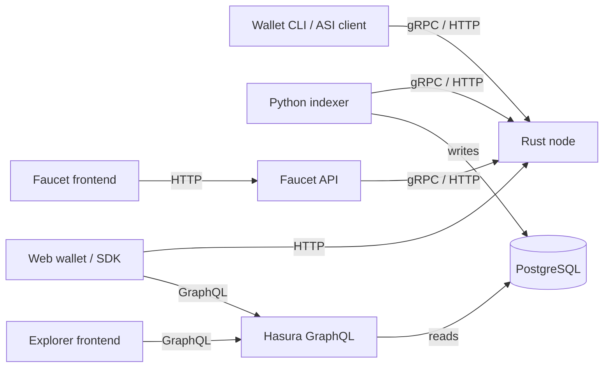

# Technical architecture

The maintained node is implemented in Rust. It combines CBC Casper consensus, Rholang execution and RSpace++ storage with P2P, gRPC and HTTP services. See the [pinned node source](https://github.com/F1R3FLY-io/f1r3node-rust/tree/e6ecf23814a306e4ad9850ea44fc753f40966db8) and [node image](/shard-nodes/validator-image/).

The indexer calls node APIs directly through its Python gRPC/HTTP client. It does not execute a standalone Rust CLI. Hasura exposes PostgreSQL; the explorer is a frontend rather than the indexing/database service.

Public implementation references: [indexer node client](https://github.com/asi-alliance/asi-chain-indexer/blob/71e80edb0bbae7dfbbab0e0393901edb70df471d/src/grpc_node_client.py), [explorer source](https://github.com/asi-alliance/asi-chain-explorer/tree/0ae1eea64234c86937b3adf39fc6a5551b228f1a) and [wallet source](https://github.com/asi-alliance/asi-chain-wallet/tree/b2e3a45f70d17c05979de38290d7a4fb7e8c42dd).

## Guides

- [Network topology](./network-topology/): roles, port boundaries and deployment inputs.
- [Data flow](./data-flow/): direct API indexing and GraphQL consumers.
- [Node components](./component-diagrams/node/) and [explorer components](./component-diagrams/explorer/).
- [Container images](/general/container-images/): exact image/source pairs.

The detailed [transaction](./sequence-diagrams/transaction/), [balance](./sequence-diagrams/balance/), [wallet](./component-diagrams/wallet/) and [state](./state-diagrams/) diagrams retain earlier material and await revision-specific review. Consult [documentation status](/general/documentation-status/) before treating them as an API or runtime contract.
