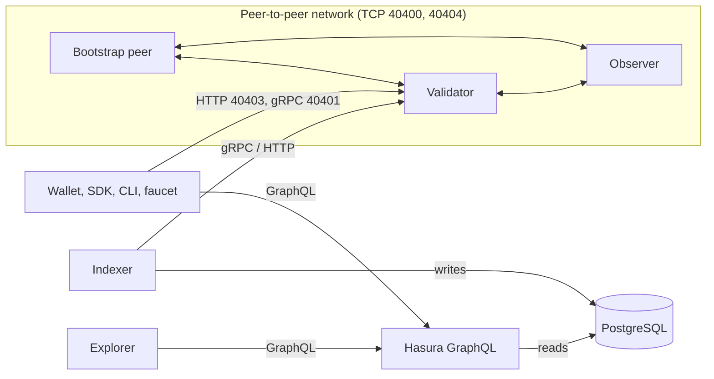

# Network Topology

This page describes node roles and default listeners. Current DevNet addresses are on [Network Endpoints](/general/endpoints/).

## Roles

| Role | Responsibility |
|---|---|
| Bootstrap peer | First contact for a joining node; genesis-ceremony participation depends on configuration |
| Validator | Proposes blocks according to its bonded stake and shard admission |
| Observer | Follows chain state and serves queries without proposing blocks |
| Indexer | Reads node APIs and stores derived chain data in PostgreSQL |
| Hasura | Exposes approved database data through GraphQL |
| Applications | Wallet, SDK, CLI and faucet send requests to a node API and read history through GraphQL |

A bootstrap peer is not automatically a bonded validator. After the first connection every node talks to its peers through discovery, so the bootstrap peer is not a hub for traffic.



Applications and the indexer can talk to any node that exposes the API ports, including an observer. The diagram shows a validator because that is the public entry point of DevNet.

## Ports and Access

| Port | Protocol | Purpose | Access |
|---|---|---|---|
| 40400 | TCP | P2P transport between nodes | Open to peers |
| 40401 | TCP, gRPC | External API, Deploy service | Public behind a network ACL |
| 40402 | TCP, gRPC | Internal API: Repl, Deploy, Propose, Lsp | Private |
| 40403 | TCP, HTTP | Public HTTP API: `/api/*` including deploy submission, `/status`, `/metrics` | Public behind a gateway or ACL |
| 40404 | TCP, gRPC | Peer discovery (Kademlia) | Open to peers |
| 40405 | TCP, HTTP | Admin HTTP API, for example `/api/propose` | Private |

These are the Rust node defaults. Container ports and host mappings differ between setups; see [Validator Image](/shard-nodes/validator-image/#default-container-ports) for the container side.

Discovery runs over TCP. The node's discovery client opens a gRPC channel to `http://<host>:<discovery port>`, even though the field in the peer record is called `udp_port`. Allowing `40404/udp` does nothing for discovery.

All API listeners bind to `0.0.0.0` by default (`api-server.host`), so the node does not keep 40402 or 40405 local by itself. Restrict them with a firewall or by setting `api-server.host`. The `/metrics` route is registered on the public HTTP router, so it is reachable on 40403; a public gateway in front of the node should pass only the routes you intend to publish.

## Firewall

A node that other nodes must reach needs inbound P2P and discovery:

```bash
sudo ufw allow 40400/tcp
sudo ufw allow 40404/tcp
```

Open the API ports only when the node serves public clients, and prefer a gateway or an ACL over a bare rule:

```bash
sudo ufw allow 40403/tcp
```

Leave 40402 and 40405 closed to the outside.
