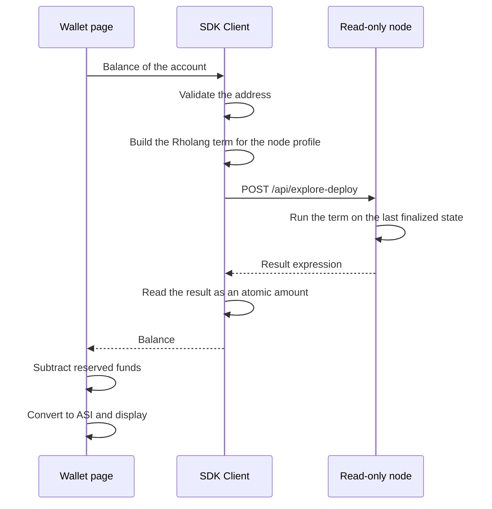

# Balance Query Flow

How the wallet reads and shows the balance of an account.

← [Back to Sequence Diagrams](../)

## Overview

A balance query is an exploratory deploy. The node runs a short Rholang term against the state of the last finalized block and returns the result, so the query is neither signed nor written to a block and costs the user nothing. The node still limits it: a query that runs out of phlogiston is rejected with `out_of_phlogistons`, and one that runs too long times out.

The query goes to the node behind `ReadOnlyURL`, see [Wallet Architecture](../../component-diagrams/wallet/#network-connections).

## Query Flow



| Step | Description |
|------|-------------|
| Validate | An address that does not pass validation ends the flow with an error |
| Term | The term depends on `nodeApiProfile` (see below) |
| Request | The body is `{ "term": "..." }` for a Rust node. For a Scala node it is the bare term string |
| Result | The first expression of the reply is the balance. If the vault reports an error, the reply holds the error text instead |
| Reserved funds | The wallet shows the available balance: the balance minus the amounts reserved by pending transfers and deploys of this account, never below zero |

Because the node reads the last finalized block, a transfer that was just sent changes the balance only after it is finalized. The reservation covers that gap, see [Transaction Flow](../transaction/).

## Key Details

### Atomic Units

The node returns the balance as an integer number of atomic units. The token has 8 decimal places.

| Unit | Value |
|------|-------|
| 1 ASI | 100,000,000 atomic units |
| 1 atomic unit | 0.00000001 ASI |

The SDK converts with `toDisplayAmount` and `toAtomicAmount`.

### Query Rholang

The SDK builds the term from the address with the vault contract of the node. Scala nodes register it as `rho:rchain:asiVault`, Rust nodes as `rho:vault:system`.

Scala profile:

```rholang
new return, rl(`rho:registry:lookup`), ASIVaultCh, vaultCh in {
  rl!(`rho:rchain:asiVault`, *ASIVaultCh) |
  for (@(_, ASIVault) <- ASIVaultCh) {
    @ASIVault!("findOrCreate", "<address>", *vaultCh) |
    for (@maybeVault <- vaultCh) {
      match maybeVault {
        (true, vault) => @vault!("balance", *return)
        (false, err)  => return!(err)
      }
    }
  }
}
```

Rust profile:

```rholang
new return, rl(`rho:registry:lookup`), systemVaultCh, vaultCh, balanceCh in {
  rl!(`rho:vault:system`, *systemVaultCh) |
  for (@(_, SystemVault) <- systemVaultCh) {
    @SystemVault!("findOrCreate", "<address>", *vaultCh) |
    for (@either <- vaultCh) {
      match either {
        (true, vault) => {
          @vault!("balance", *balanceCh) |
          for (@balance <- balanceCh) {
            return!(balance)
          }
        }
        (false, errorMsg) => {
          return!(errorMsg)
        }
      }
    }
  }
}
```

::: warning Balance expression on Rust nodes
A Rust node returns the balance as `ExprBigInt`, while a Scala node returns `ExprInt`. Wallet SDK 2.1.0 reads only `ExprInt`, so with the `rust` profile `getBalance` fails with `BALANCE_UNAVAILABLE` (the node returned no balance expression), and so does any transfer, because it checks the balance first.
:::

### Auto-Refresh

While they are open, the Dashboard and Send pages refresh the balance every 30 seconds, and the Dashboard and History pages refresh the history at the same interval. Cached data that no open page uses is dropped after 30 seconds. After a transfer or a deploy the cache is invalidated twice: right after the deploy is submitted and again when the wallet stops watching it.

---

## Related Documentation

- [Transaction Flow](../transaction/) - Sending tokens
- [Wallet Architecture](../../component-diagrams/wallet/) - Wallet internals
- [Wallet Usage Guide](/wallet/usage/) - How to use the wallet
