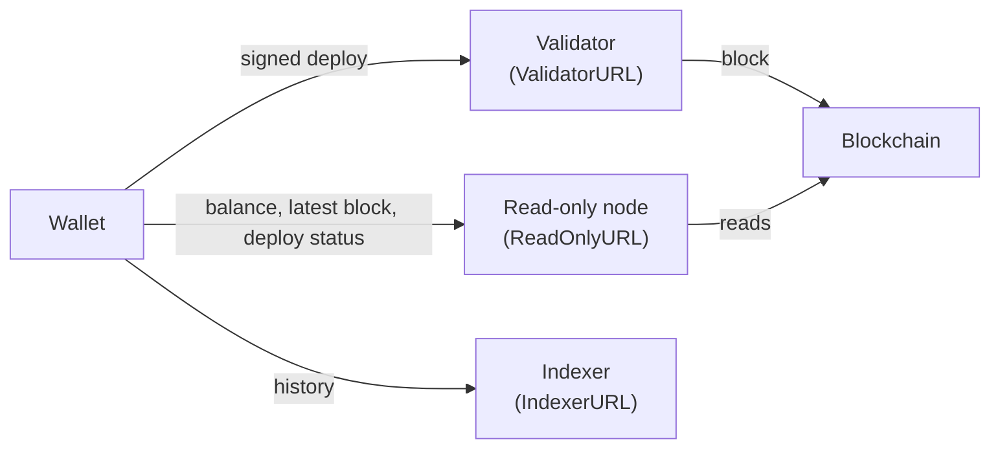

# Sequence Diagrams

Interaction flows between the wallet and the nodes of ASI:Chain.

← [Back to Architecture Overview](../)

## Available Diagrams

### [Transaction Flow](./transaction/)

From the moment the user sends tokens to the moment the transfer is finalized.

- Check and reserve the amount
- Sign the deploy
- Submit it to the validator
- Watch the deploy until it is finalized

### [Balance Query](./balance/)

How the wallet reads and shows the balance of an account.

- Read-only query to the node
- Funds reserved by pending operations
- Atomic units and refresh interval

## Quick Reference

The wallet takes the address of every node role from the network configuration. See [Wallet Architecture](../component-diagrams/wallet/#network-connections) for the roles.

| Operation | Calls | Addresses used |
|-----------|-------|----------------|
| Send tokens | `GET /api/blocks`, `POST /api/deploy`, then `GET /api/deploy/{id}` until finalized | `ReadOnlyURL` and `ValidatorURL` |
| Deploy contract | The same calls as for sending tokens | `ReadOnlyURL` and `ValidatorURL` |
| Check balance | `POST /api/explore-deploy` | `ReadOnlyURL` |
| Transaction history | GraphQL query | `IndexerURL` |

## Simplified Flow

---

## Related Documentation

- [Component Diagrams](../component-diagrams/) - Internal architecture
- [State Diagrams](../state-diagrams/) - Node lifecycle
- [Wallet Usage](/wallet/usage/) - User guide
