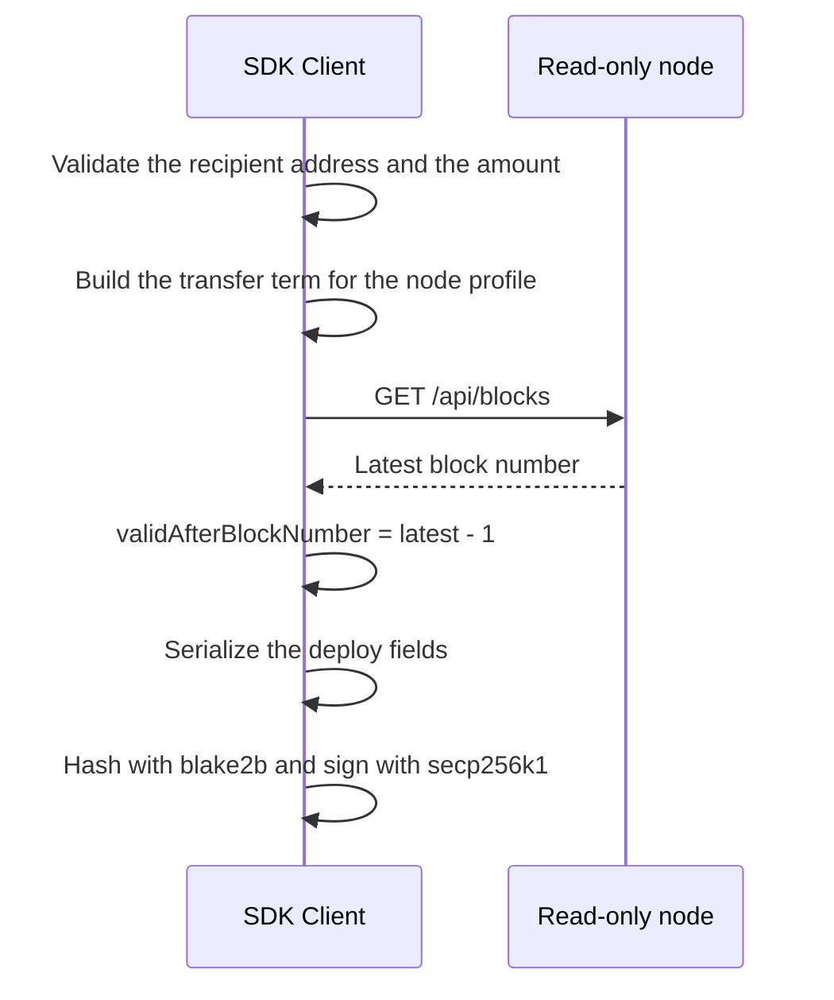
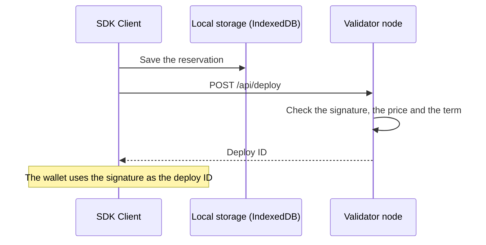
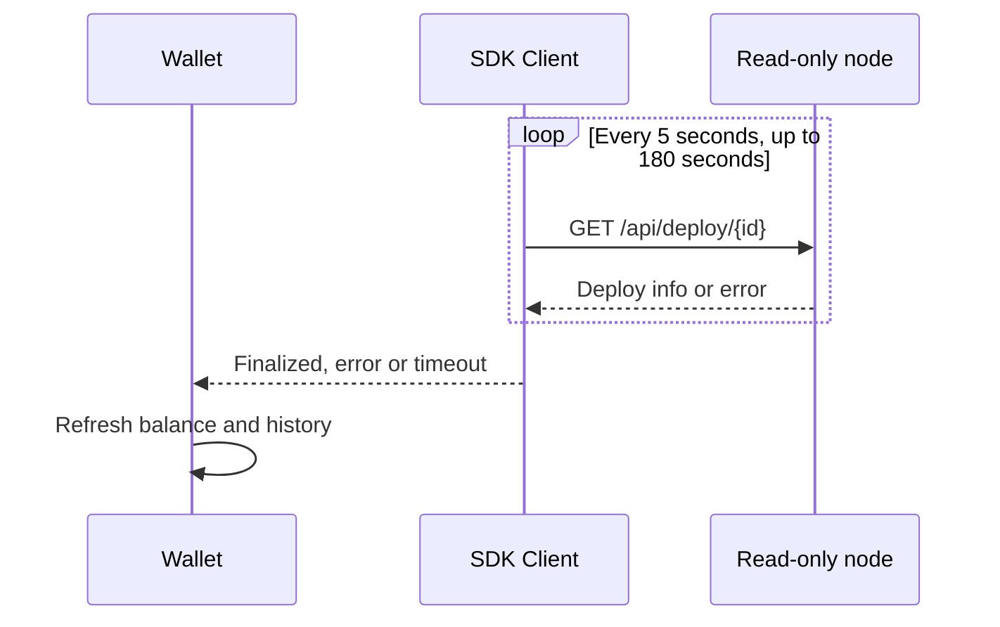

# Transaction Flow

Complete sequence from the moment the user sends tokens to the moment the transfer is finalized.

← [Back to Sequence Diagrams](/architecture/sequence-diagrams/)

## Overview

A token transfer goes through four phases:

1. Check and reserve: validate the input and set the amount aside
2. Signing: build the Rholang term and sign the deploy
3. Submission: send the signed deploy to the validator
4. Confirmation: poll the node until the deploy is finalized

A transfer is a deploy of a Rholang term that moves tokens between two vaults. Deploying a contract from the Deploy page uses the same phases with a different term.

The wallet calls the SDK `Client`, and the SDK talks to the nodes behind `ValidatorURL` and `ReadOnlyURL` (see [Wallet Architecture](/architecture/component-diagrams/wallet/#network-connections)).

## Phase 1: Check and Reserve

<Diagram name="transfer-checks" caption="Messages between the user, the wallet, the SDK and the read-only node while a transfer is checked and funds are reserved." />

| Messages | Step | Description |
|----------|------|-------------|
| 1-2 | User input | Recipient address and amount. The wallet does not send to `0x...` addresses |
| 3-5 | Password | Needed only while the signing session is closed. By default a session stays open for 15 minutes after unlocking |
| 6 | Reserve | The amount held for the transfer is `amount + GasFee.MAX`, where `GasFee.MAX` is 250000 atomic units (0.0025 ASI) |
| 7-9 | Balance check | The SDK reads the balance as described in [Balance Query](/architecture/sequence-diagrams/balance/). If it does not cover the reserve, the transfer stops with an error before anything is signed |

The private key is not kept in the Redux store. The SDK decrypts it only while the signing session is open.

## Phase 2: Signing

| Field | Value |
|-------|-------|
| `term` | Rholang term that transfers `amount` from the account to the recipient. Scala nodes use `rho:rchain:asiVault`, Rust nodes use `rho:vault:system` |
| `timestamp` | Current time in milliseconds |
| `phloPrice` | 1 |
| `phloLimit` | 500000 |
| `validAfterBlockNumber` | Number of the latest block minus 1 |
| `shardId` | `root` |

The result is a signed deploy: the serialized data, the public key of the deployer, the signature in hex and the algorithm `secp256k1`. If the node cannot return the latest block number, signing fails with `Invalid block number`.

## Phase 3: Submission

| Step | Description |
|------|-------------|
| Save reservation | The reservation is written to the browser storage before the request, so the amount stays held even if the page closes |
| Submit | `POST /api/deploy` with the signed deploy |
| Validate | The node checks the signature algorithm, the phlo price against its minimum price and the term |
| Deploy ID | The node returns the signature of the deploy in hex. The wallet tracks the transfer by that signature |

If the node refuses the deploy with a 4xx answer, the reservation is released. If the outcome is unknown, for example because of a network error, the reservation stays, because the deploy may still reach the network.

The validator answers `400` for a malformed request or a bad term and `409` for a duplicate deploy. Other failures come back as `422`, `500` or `502`.

## Phase 4: Confirmation

The SDK maps every answer to a status.

| Status | Meaning |
|--------|---------|
| `Deploying` | The node does not report a block for the deploy yet |
| `IncludedInBlock` | The deploy is in a block that is not finalized |
| `Finalized` | The block is finalized. The transfer is confirmed |
| `CheckingError` | The request failed. Polling goes on |

If the deploy is not finalized within 180 seconds, the watch ends with `DeployTimeoutError`. When it ends, the wallet invalidates the cached balance and history.

For a Scala node the SDK reads the `faultTolerance` field of the answer and treats the deploy as finalized at 0.99 or above. For a Rust node the SDK expects the same field with a threshold of 0.33.

::: warning Finalization on Rust nodes
The answer of a Rust node to `GET /api/deploy/{id}` has no `faultTolerance` field. It reports `isFinalized` and `finalizationState` instead. Wallet SDK 2.1.0 with the `rust` profile therefore keeps the status at `IncludedInBlock` for a deploy that the node already reports as `Finalized`, and the watch ends with `DeployTimeoutError`. A Rust node returns the deploy as soon as a block it knows contains it, with `isFinalized: false` until that block is finalized. Only when no known block contains the deploy does it answer `404 deploy_not_found`, which the SDK reports as `CheckingError`.
:::

## Errors

| Error | When |
|-------|------|
| `BalanceUnavailableError` | The balance could not be read in phase 1 |
| `DeploySubmissionRejectedError` | The validator refused the deploy with a 4xx answer. The reservation is released |
| `ApiRequestError` | A request to a node failed |
| `DeployTimeoutError` | The deploy was not finalized within the watch time |

## Deploying a Contract

The Deploy page follows the same four phases. It differs in two places. The term is the user's Rholang code, and the reserved amount is `phloLimit * phloPrice`. The page sets the phlo limit to 100000000 by default.

---

## Related Documentation

- [Wallet Architecture](/architecture/component-diagrams/wallet/): wallet internals
- [Balance Query](/architecture/sequence-diagrams/balance/): how balance checks work
- [Send Tokens Guide](/wallet/usage/): step-by-step guide
