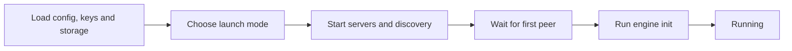

# State Diagrams

Node startup and runtime behavior of the Rust node. The diagrams follow `node_runtime.rs` and `casper_launch.rs` in [asi-chain-rust-node](https://github.com/asi-alliance/asi-chain-rust-node), and the log lines quoted on these pages come from the `node-rust` image `0.4.46-dev.20261104-e18defd44d43`.

← [Back to Architecture Overview](../)

## Pages

- [Node Startup](./startup/) covers the steps from process start to the Running state and the four launch modes.
- [Running Node](./operations/) covers what a validator and a read-only node do after startup.

## Lifecycle

The node has no single state machine for startup. It runs a fixed sequence of steps, and the launch mode chosen in step 2 decides how it reaches the Running state.



A node started with `--standalone` skips the wait for the first peer. Once the node is Running, `GET /api/ready` returns 200 and `GET /api/status` reports `"isReady": true`.

## Check the Current State

```bash
# Readiness probe: 200 when Running, 503 before that
curl -s -o /dev/null -w "%{http_code}\n" http://localhost:40403/api/ready

# Role and readiness
curl -s http://localhost:40403/api/status

# Log line written on the transition
docker logs <container> 2>&1 | grep "transition to Running"
```

---

## Related Documentation

- [Component Diagrams](../component-diagrams/) - Node internals
- [Sequence Diagrams](../sequence-diagrams/) - Interaction flows
- [Troubleshooting](/quick-start/troubleshooting/) - Common issues
