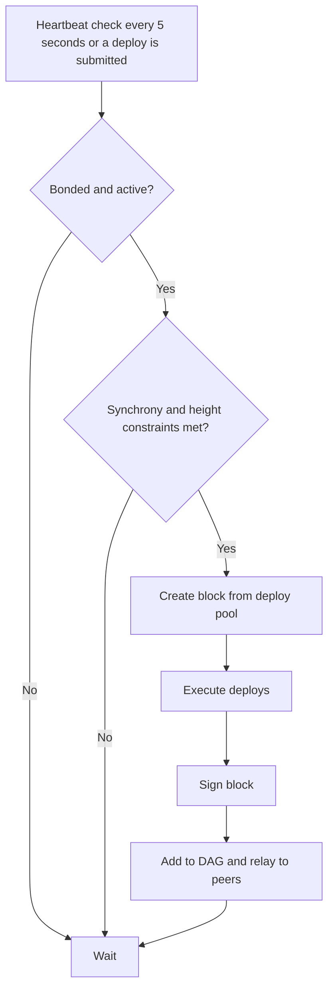
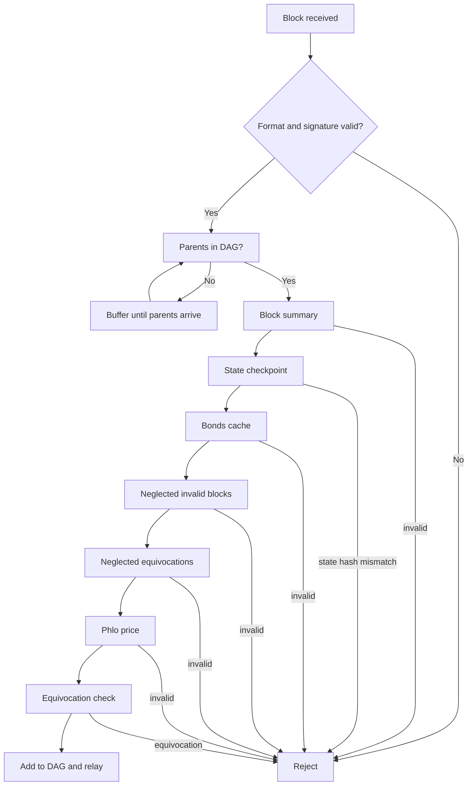

# Running Node

What the node does after it reaches the Running state.

← [Back to State Diagrams](/architecture/state-diagrams/)

## Roles

A node in the Running state has one of two roles, and both use the same engine.

| Role | `/api/status` | Behavior |
|------|---------------|----------|
| Validator | `isValidator: true` | Proposes blocks while it is bonded and in the active set, validates blocks from peers, serves the API. |
| Read-only | `isValidator: false`, `isReadOnly: true` | Receives and validates blocks, keeps the DAG and serves queries. Does not propose. |

`isValidator` reports only that the node has a validator key configured, not that it is bonded. A validator that is not yet bonded behaves like a read-only node. It skips proposing and picks up its bond without a restart once the bond takes effect at an epoch boundary.

## Block Proposal

A validator proposes through the heartbeat proposer, which is enabled by default.



The proposer checks every `casper.heartbeat.check-interval`, which is 5 seconds by default, and a deploy submission wakes it immediately. It proposes when there are pending deploys. When the last finalized block is older than `max-lfb-age` (the maximum age of the last finalized block, 5 seconds by default), the shard counts as stalled, and every bonded validator proposes at most one empty recovery block per `stale-recovery-min-interval` until finalization resumes. That interval defaults to 1.5 times the check interval. A validator waits at least `self-propose-cooldown` (3 seconds by default) between its own proposals. A single-node development shard can set `casper.heartbeat.enabled = false` and rely on `autopropose` or on an operator calling the admin API.

## Block Validation

A block from a peer passes these checks in order. A block that fails one of them is rejected and handled as invalid.



Voting is not a separate step. A validator endorses blocks by listing them in the justifications of its next block, and finalization is computed from the DAG by the clique oracle, so every node reaches it on its own.

## Connection Loss

The node has no Disconnected or Reconnecting state. Two background loops keep the peer list current.

- The clear-connections loop checks peers every `cleanup-interval` (10 seconds) and drops a peer after `heartbeat-failure-threshold` (3) failed checks in a row. A single success resets the count.
- The node discovery loop looks up new peers through Kademlia, so a dropped peer can return when it answers again.

Read the peer count and the last finalized block from the status endpoint.

```bash
curl -s http://localhost:40403/api/status
```

---

## Related Documentation

- [Node Startup](/architecture/state-diagrams/startup/): before Running
- [Component Diagrams](/architecture/component-diagrams/): node internals
- [Troubleshooting](/quick-start/troubleshooting/): common issues
