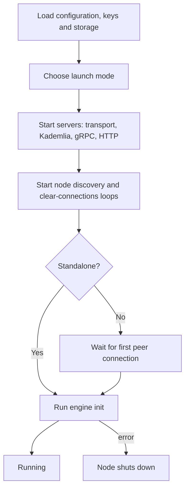
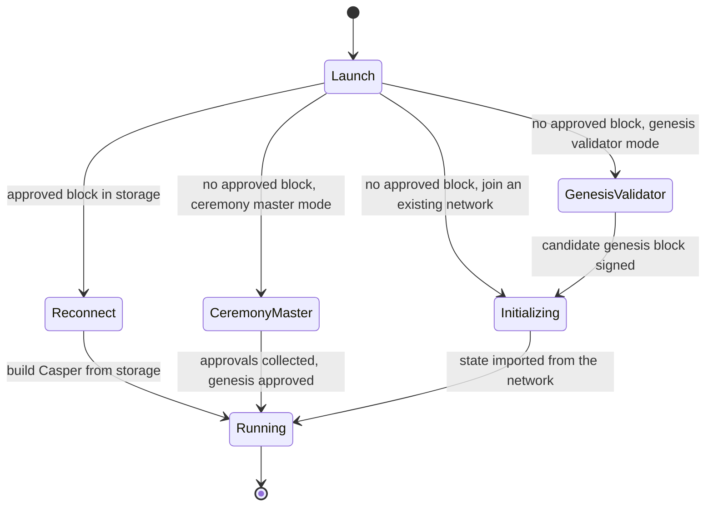

# Node Startup

How the Rust node gets from process start to the Running state.

← [Back to State Diagrams](/architecture/state-diagrams/)

## Startup Sequence



1. The node loads its configuration, the TLS key that defines its node ID, and its stores, and then picks one of four launch modes (next section). The log line `Launching Casper...` marks this step, and the chosen mode is logged as one `Approved block ...` line.
2. The transport server and the Kademlia discovery server start, followed by the gRPC and HTTP API servers. The node discovery loop and the clear-connections loop start next, so that they can help to find the first peer.
3. Unless the node runs with `--standalone`, it polls once per second until it has at least one peer connection.
4. The engine selected in step 1 runs its `init`, which is where the modes differ.
5. If engine init fails, the node logs `engine initialization failed` and shuts down. There is no separate Failed state to recover from.

## Launch Modes



| Mode | Condition | Log line at launch | Path to Running |
|------|-----------|--------------------|-----------------|
| Reconnect | The block store holds an approved block, which is any restart on existing data. | `Approved block found, reconnecting to existing network` | Builds Casper from local storage and goes to Running directly, in about a second. |
| Genesis validator | No approved block and `genesis_validator_mode` is set. | `Approved block not found, taking part in ceremony as genesis validator` | Verifies and signs the candidate genesis block and then moves to Initializing, where it waits for the approved block like a joining node. |
| Ceremony master | No approved block and `ceremony_master_mode` is set. A standalone node starts in this mode. | `Approved block not found, taking part in ceremony as ceremony master` | Builds the genesis block, waits for approvals from the genesis validators (zero in standalone mode), and checks every 2 seconds for the approved block before going to Running. |
| Join | No approved block and neither ceremony mode is set. | `Approved block not found, connecting to existing network` | Initializing. |

### Initializing

A node that joins an existing shard asks its peers for the approved block. If a peer has none yet and answers `NoApprovedBlockAvailable`, the node asks again after 10 seconds.

Once it has the approved block, the node downloads the blocks and the state of the last finalized window from the bootstrap peer. Each request times out after 5 seconds, and the whole download has a 600-second deadline. Then it rebuilds the DAG, creates Casper and moves to Running. Against a healthy shard this takes one to two minutes and about a hundred fetched blocks.

A restart on the same data directory takes the Reconnect path and does not download anything again.

## Check Readiness

The transition to Running is logged as one line.

```
Making a transition to Running state. Approved Block #<height> (<hash>...)
```

Until that line appears, `GET /api/ready` returns 503 and `GET /api/status` reports `"isReady": false` and `lastFinalizedBlockNumber: -1`. A node that waits for the genesis ceremony stays in this state for the whole ceremony.

```bash
curl -s -o /dev/null -w "%{http_code}\n" http://localhost:40403/api/ready
```

## Common Issues

### No Peers

The node connects out but never receives anything, or the peer count stays at 0.

- `--host` must be an address that the other nodes can reach, because peers dial it back during the handshake.
- If the shard advertises private or Docker hostnames, start the joiner with `--allow-private-addresses`.
- Check the transport port 40400 and the discovery port 40404 on both sides. Both use TCP.

### Initializing Does Not Finish

Search the log for the line that starts the state download.

```bash
docker logs <container> 2>&1 | grep "request_approved_state"
```

The line shows `min_height`, the lowest block of the imported window. If the node stays in Initializing, save the logs and ask the shard operator.

### Data Directory

Do not delete the data directory of a node that its peers already know. The TLS certificate inside it is the node identity, so a wiped directory gives the node a new identity and a full join, while the peers still hold the old one in their routing tables.

---

## Related Documentation

- [Running Node](/architecture/state-diagrams/operations/): after startup
- [Validator Setup](/quick-start/join-validator/): setup guide
- [Troubleshooting](/quick-start/troubleshooting/): common issues
